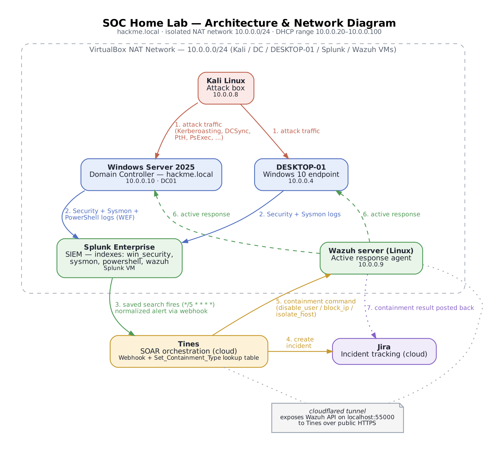
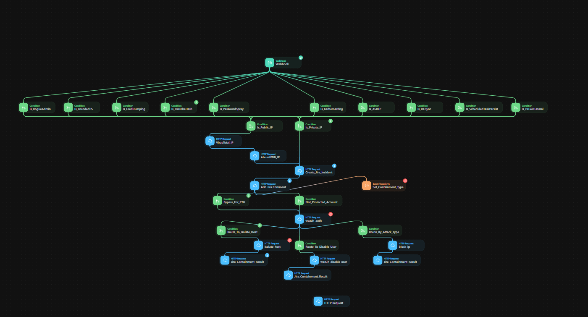
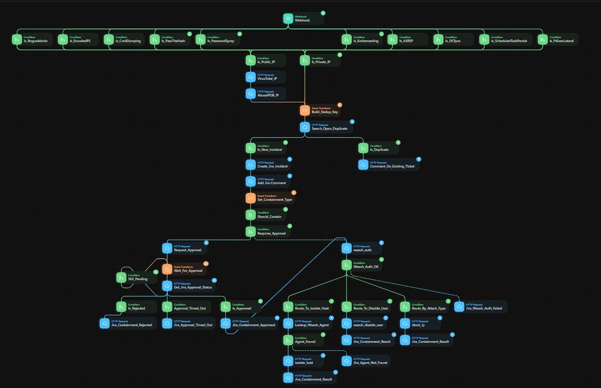
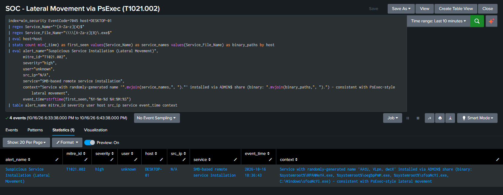
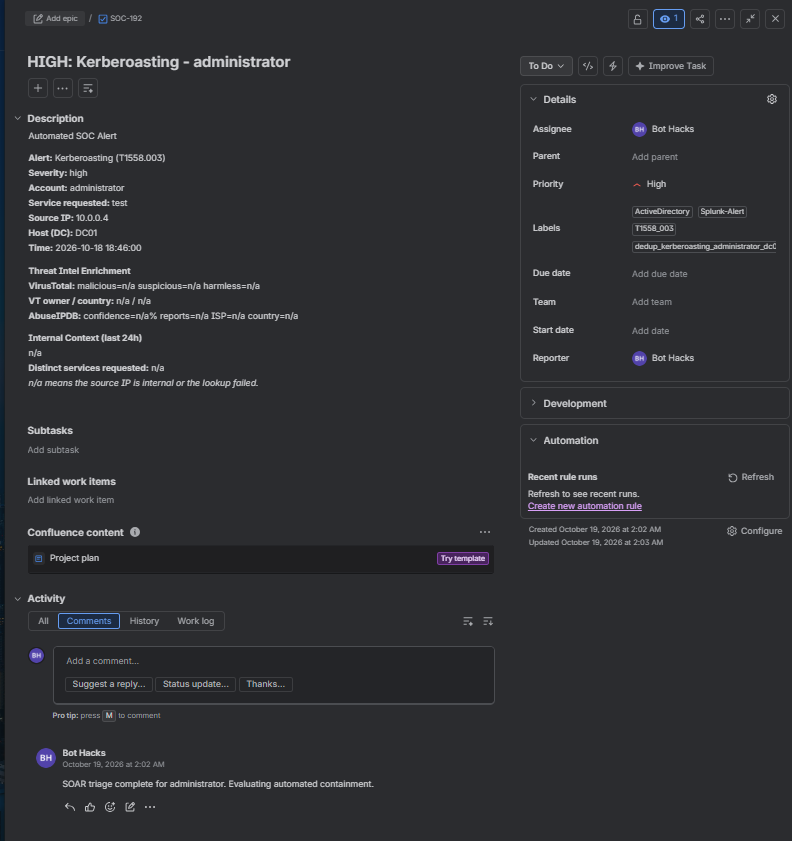
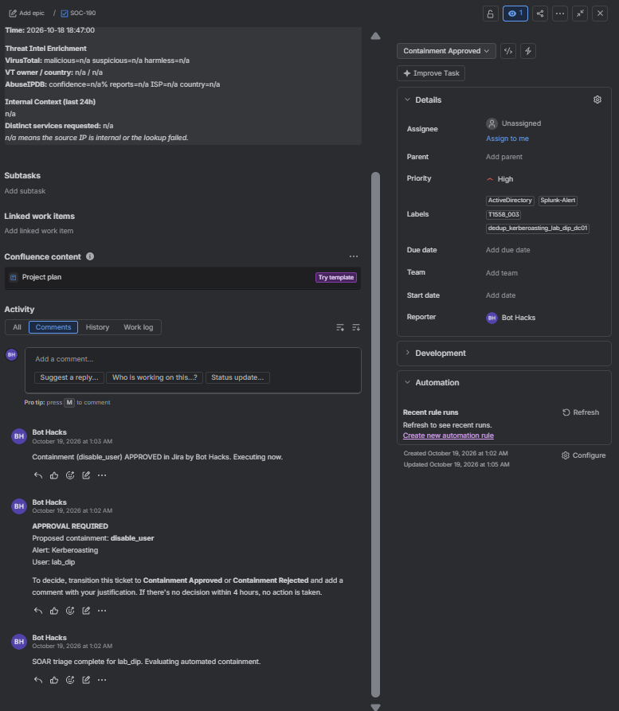
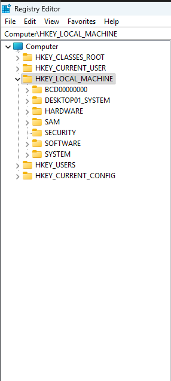
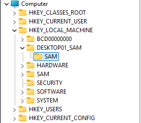
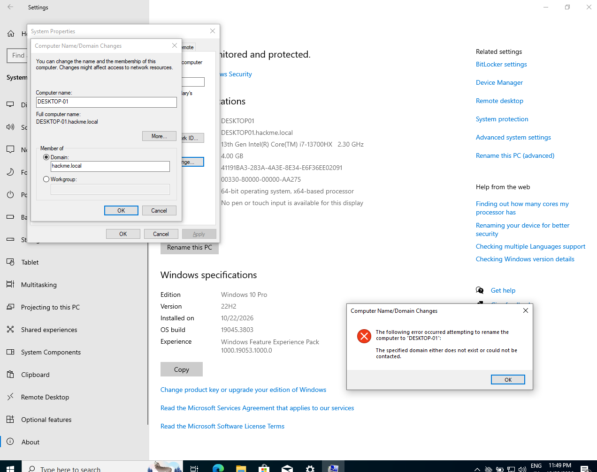

# SOAR + AD Attack Detection Lab

A home SOC lab: a real Active Directory domain is attacked with ten MITRE ATT&CK techniques,
detected by hand-written Splunk searches, and automatically contained through a Tines SOAR
pipeline wired to Wazuh active response. Full write-up: [`/docs`](docs).

## What's in here

| Folder | Contents |
| --- | --- |
| [`/docs`](docs) | The full lab report (PDF) and the architecture/network diagram |
| [`/splunk`](splunk) | The final Splunk search (`.spl`) for each of the 10 detections |
| [`/tines`](tines) | The Tines story structure, the `Set_Containment_Type` lookup table, and before/after screenshots of the routing rebuild |
| [`/wazuh`](wazuh) | How the Wazuh active-response side is wired (`disable_user`, `block_ip`, `isolate_host`) |
| [`/screenshots`](screenshots) | Proof-of-work: the Tines story, Splunk detection results, and the Jira tickets it opened |

## Architecture

| Layer | Component | Role |
| --- | --- | --- |
| Attack | Kali Linux (`10.0.0.8`) | Runs all 10 attacks (Impacket, mostly) against the domain |
| Targets | Windows Server 2025 DC — `hackme.local` (`10.0.0.10`) · Windows 10 `DESKTOP-01` (`10.0.0.4`) | Generate Security, Sysmon, PowerShell logs |
| Collection | Windows Event Forwarding + Sysmon (Olaf's modular config) | Ships logs into Splunk |
| Detection | Splunk Enterprise, indexes `win_security` / `sysmon` / `powershell` / `wazuh` | One scheduled search per technique, each posting a normalized alert to a webhook |
| Orchestration | Tines | Classifies the alert, opens/dedupes a Jira incident, decides containment via a single lookup table |
| Containment | Wazuh active response (`10.0.0.9`), reached over a `cloudflared` tunnel | Executes `disable_user`, `block_ip`, or `isolate_host` |

All 10 VMs/services sit on one isolated VirtualBox NAT network, `10.0.0.0/24` — this lab was
never exposed to a real network.

## The 10 techniques

Names match the saved searches exactly as they're titled in Splunk (**SOC - \<name\>**), all scheduled `*/5 * * * *`:

| # | Splunk saved search | MITRE ID | Detection | Containment |
| --- | --- | --- | --- | --- |
| 1 | SOC - Kerberoasting | T1558.003 | [`splunk/01_kerberoasting_T1558.003.spl`](splunk/01_kerberoasting_T1558.003.spl) | `disable_user` |
| 2 | SOC - AS-REP Roasting | T1558.004 | [`splunk/02_asrep_roasting_T1558.004.spl`](splunk/02_asrep_roasting_T1558.004.spl) | `disable_user` |
| 3 | SOC - DCSync | T1003.006 | [`splunk/03_dcsync_T1003.006.spl`](splunk/03_dcsync_T1003.006.spl) | `isolate_host` |
| 4 | SOC - Credential Dumping via Remote Registry | T1003.002 | [`splunk/04_credential_dumping_remote_registry_T1003.002.spl`](splunk/04_credential_dumping_remote_registry_T1003.002.spl) | `isolate_host` |
| 5 | SOC - Pass-the-Hash | T1550.002 | [`splunk/05_pass_the_hash_T1550.002.spl`](splunk/05_pass_the_hash_T1550.002.spl) | `disable_user` |
| 6 | SOC - Encoded PowerShell Execution | T1059.001 | [`splunk/06_encoded_powershell_execution_T1059.001.spl`](splunk/06_encoded_powershell_execution_T1059.001.spl) | `isolate_host` |
| 7 | SOC - Scheduled Task Persistence | T1053.005 | [`splunk/07_scheduled_task_persistence_T1053.005.spl`](splunk/07_scheduled_task_persistence_T1053.005.spl) | `disable_user` |
| 8 | SOC - Password Spraying | T1110.003 | [`splunk/08_password_spraying_T1110.003.spl`](splunk/08_password_spraying_T1110.003.spl) | `block_ip` |
| 9 | SOC - Rogue Privileged Account Creation | T1136.002 | [`splunk/09_rogue_privileged_account_creation_T1136.002.spl`](splunk/09_rogue_privileged_account_creation_T1136.002.spl) | `disable_user` |
| 10 | SOC - Lateral Movement via PsExec | T1021.002 | [`splunk/10_psexec_lateral_movement_T1021.002.spl`](splunk/10_psexec_lateral_movement_T1021.002.spl) | `isolate_host` |

[`splunk/04a_lsass_access_supplementary_sysmon_T1003.002.spl`](splunk/04a_lsass_access_supplementary_sysmon_T1003.002.spl)
is a supplementary Sysmon-based LSASS-access query for the same technique (T1003.002) — it's not
one of the 10 scheduled saved searches above, just an additional detection angle documented
alongside it.

Every search posts a normalized JSON payload to the same Tines webhook (`alert_name`,
`mitre_id`, `severity`, `user`, `host`, `src_ip`, `event_time`) — that shared schema is what
lets one lookup table route all ten.

## The engineering story: regex lists → one lookup table

The first version of the Tines story routed containment with a separate regex condition per
branch — adding an 11th detection meant editing several condition nodes and hoping none were
missed:

That was replaced with a single formula node, `Set_Containment_Type`, holding one lookup table
(`alert_name → containment_type`). Adding a detection to containment now means adding one row to
that table — see [`/tines`](tines) for the full before/after and the formula itself:

The rebuild was verified with three live, end-to-end tests — real alerts through the real
pipeline, not synthetic Tines test events — covering all three containment types
(`disable_user`, `block_ip`, `isolate_host`). Full results in the report.

## Proof of work

| | |
| --- | --- |
|  | Splunk result: the PsExec lateral-movement detection firing on a real service-install event |
|  | The Jira incident Tines opened automatically for a Kerberoasting alert |
|  | SOAR approval workflow: containment proposed, approved, and executed, all logged as Jira comments |
|  /  | Evidence of the SAM/registry credential-dumping technique on the endpoint |
|  | `DESKTOP-01` joined to `hackme.local` |

## Build it yourself

### Prerequisites

- VirtualBox (or any hypervisor) with one NAT Network shared by every VM
- Windows Server 2025 (Domain Controller) and Windows 10 (endpoint) ISOs
- Kali Linux (attack box)
- Splunk Enterprise (free dev license is enough)
- A Wazuh server (Linux) + `cloudflared`
- A Tines account (the free tier works)
- A Jira Cloud project (or swap in another ticketing tool)

### Steps

1. **Stand up the domain.** Promote the Windows Server 2025 VM to a DC for `hackme.local`.
   Domain-join `DESKTOP-01`. All four VMs (DC, endpoint, Kali, Wazuh) plus the Splunk VM share
   one VirtualBox NAT Network — pick a DHCP range (this lab used `10.0.0.20`–`10.0.0.100`) and
   assign static-ish addresses outside it for the servers.
2. **Turn on logging.** Enable Windows Security auditing (Advanced Audit Policy via GPO, enough
   to cover 4624/4625/4662/4688/4698/4720/4728/4768/4769/5145/7036/7040/7045), install Olaf's
   [`sysmon-modular`](https://github.com/olafhartong/sysmon-modular) config, and enable
   PowerShell Script Block Logging (4104) — on both the DC and the endpoint.
3. **Stand up Splunk.** Create the four indexes (`win_security`, `sysmon`, `powershell`,
   `wazuh`), install a forwarder on both Windows boxes, and confirm events are landing with
   `index=win_security | stats count by host, EventCode`.
4. **Add the 10 detections.** One scheduled saved search per technique from [`/splunk`](splunk),
   each firing every 5 minutes (`*/5 * * * *`) and posting its result to a Tines webhook URL via
   an alert action.
5. **Build the Tines story.** Webhook in, one condition per `alert_name`, Jira incident
   creation/dedup, the `Set_Containment_Type` lookup table, and three containment branches —
   see [`/tines`](tines) for the exact wiring.
6. **Wire Wazuh.** Install the Wazuh agent on the DC and endpoint, write the three
   active-response scripts (`disable-ad-user.cmd`, a firewall-block action, `isolate-host.ps1`),
   and expose the Wazuh API to Tines through a `cloudflared` tunnel — see [`/wazuh`](wazuh).
7. **Attack and verify.** Run each technique from Kali, confirm the Splunk search fires, the
   Jira ticket opens, and the correct containment action executes. Clean up test accounts/rules
   between runs (see [`/wazuh`](wazuh) for the rollback commands).

### A note on secrets

Nothing in this repo contains live credentials, API keys, or the `cloudflared` tunnel URL — all
of those are placeholders (`<<WAZUH_API_TOKEN>>`, `YOUR-TUNNEL.trycloudflare.com`, etc.). If
you're adapting this for your own lab, generate your own Tines/Jira/Wazuh credentials; nothing
here is reusable as-is, which is the point.

## Full write-up

The complete report — architecture, all 10 detections, the routing rebuild in detail, test
results, and lessons learned — is in [`/docs`](docs) as a PDF. A narrative version is on
[Medium](#) *(link added once published)*.

## License

[MIT](LICENSE) — copy, adapt, and build your own version of this lab.
